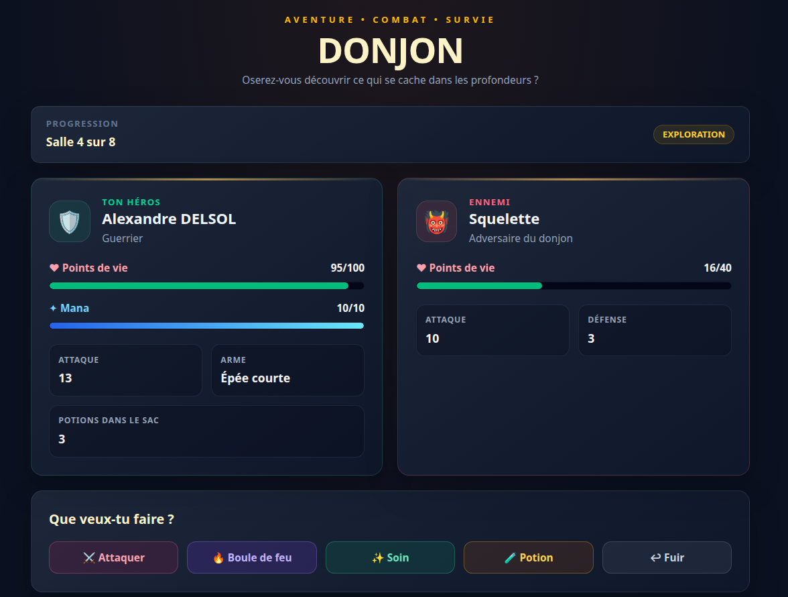

# TypeScript Dungeon

A turn-based dungeon crawler built with TypeScript, featuring combat, exploration, and a custom game interface. The game interface is in French.

This project is a progressive learning exercise focused on TypeScript fundamentals, code organization, and game state management.

## Live Demo

[🎮 Play the game online](https://typescript-dungeon.vercel.app/)

## Screenshot



## Features

- **Character creation** — Choose a hero name and class.
- **Multiple hero classes** — Warrior, Mage, and Thief, each with different statistics.
- **Dungeon exploration** — Progress through rooms and encounter enemies.
- **Turn-based combat** — Attack monsters, cast spells, heal, use potions, or attempt to flee.
- **Health and mana bars** — Track your character's resources during gameplay.
- **Combat feedback** — Display a battle log and damage animations.
- **Score system** — Get a score based on your hero's performance.
- **Replay system** — Start a new adventure after victory or defeat.
- **Responsive interface** — A dark fantasy-inspired UI with styled buttons and character panels.

## Tech Stack

- **TypeScript** — Static typing and application logic.
- **HTML5** — Semantic page structure.
- **CSS** — Custom styling and animations.
- **Tailwind CSS** — Utility-first styling.
- **jQuery** — DOM manipulation and event handling.
- **Vite** — Development server and build tooling.
- **Vitest** — Testing.

## Getting Started

### Prerequisites

- Node.js
- npm

### Installation

1. Clone the repository:

   ```bash
   git clone https://github.com/alexandre-delsol/typescript-dungeon
   ```

2. Navigate to the project directory:

   ```bash
   cd typescript-dungeon
   ```

3. Install dependencies:

   ```bash
   npm install
   ```

### Run the development server

```bash
npm run dev
```

Open the local URL displayed in your terminal.

### Run tests

```bash
npm run test
```

### Build for production

```bash
npm run build
```

> These commands assume the corresponding scripts are defined in `package.json`.

## TypeScript Concepts

This project provides practical experience with:

- Custom types and interfaces
- Union types and discriminated unions
- Type narrowing and exhaustive state handling
- Typed function parameters and return values
- Optional and `readonly` properties
- State management through explicit game states
- Separation of responsibilities across modules
- Immutability and predictable game logic
- Type-safe handling of user actions

## Project Structure

The application is organized into separate modules for game logic, character management, monsters, actions, dice rolls, inventory, logging, and display.

```text
src/
├── actions.ts
├── affichage.ts
├── de.ts
├── heros.ts
├── journal.ts
├── monstres.ts
├── objets.ts
├── partie.ts
├── saisie.ts
├── main.ts
└── style.css
```

## Learning Objectives

The main goal is to strengthen TypeScript fundamentals through a practical project while progressively improving code quality, modularity, and maintainability.

The project also explores the separation between game rules and the user interface, as well as the management of different gameplay states.

## Future Improvements

- Add automated tests for combat and exploration.
- Improve accessibility and keyboard navigation.
- Add more monsters, rooms, and items.
- Refine combat balancing and gameplay feedback.

## License

This project was created for educational purposes.